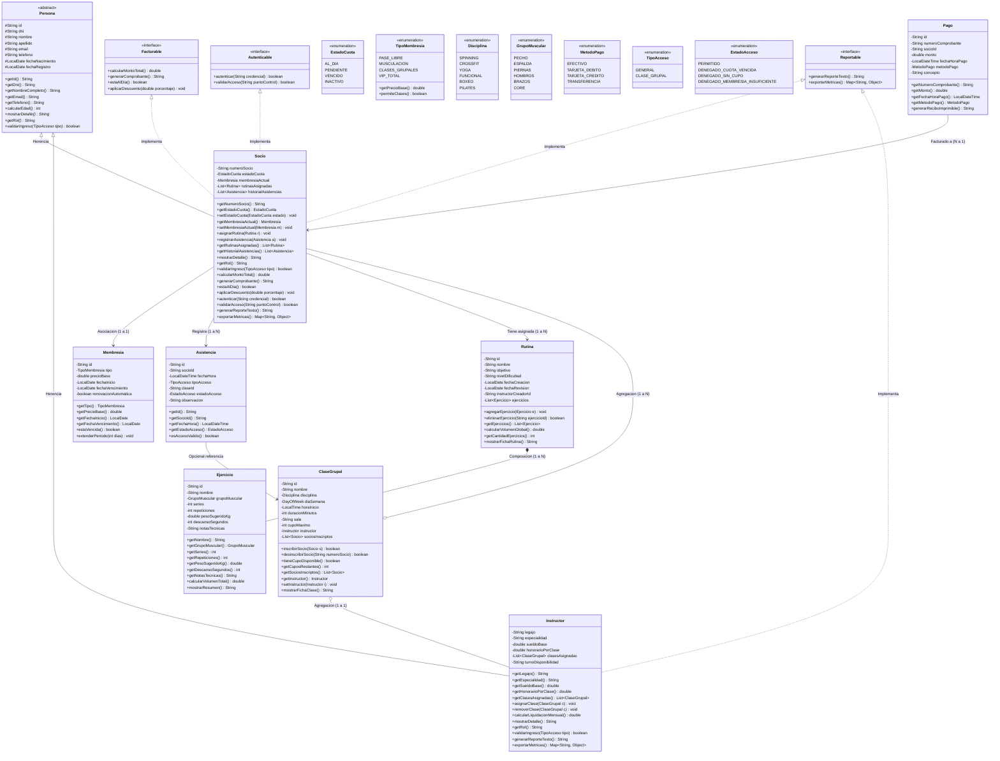
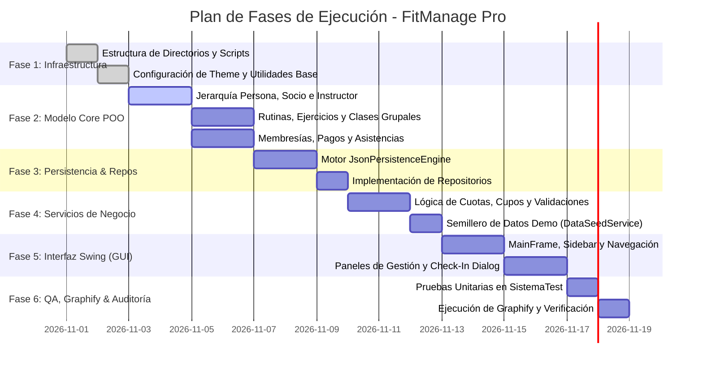

# PLAN DE EJECUCIÓN: SISTEMA INTEGRAL DE GESTIÓN PARA CLUB DEPORTIVO / GIMNASIO (FITMANAGE PRO)

> **Documento de Especificación Arquitectónica, Modelado POO y Plan de Implementación**  
> **Cátedra:** Programación Orientada a Objetos / Laboratorio de Software  
> **Versión:** 1.0.0  
> **Fecha:** Noviembre 2026  
> **Ubicación del Proyecto:** `/home/juancito/Documents/Orca/java`

---

## 1. RESUMEN EJECUTIVO Y FICHA TÉCNICA DEL PROYECTO

### 1.1 Resumen Ejecutivo
El presente proyecto concibe el diseño, modelado, implementación y auditoría de **FitManage Pro**, una plataforma de escritorio para la administración integral de un club deportivo o gimnasio de mediano/alto porte. El sistema aborda de manera unificada la gestión de socios, cuerpo de instructores, planificación y control de cupos de clases grupales multidisciplinarias, confección personalizada de rutinas de entrenamiento con desglose anatómico de ejercicios, liquidación de cuotas y membresías con emisión de comprobantes, y un módulo de control de accesos (check-in) en tiempo real con validación automática de morosidad.

El desarrollo se fundamenta en los estándares más rigurosos de la **Programación Orientada a Objetos (POO)** y los principios **SOLID**, garantizando alta cohesión, bajo acoplamiento, extensibilidad y legibilidad. Además, simula una dinámica de desarrollo colaborativo entre **6 integrantes** de un equipo de ingeniería de software, reflejando convenciones académicas, trazabilidad por autor y comentarios de integración inter-módulo.

### 1.2 Ficha Técnica

| Parámetro | Especificación Técnica |
| :--- | :--- |
| **Lenguaje de Programación** | Java SE 21 LTS (OpenJDK 21.0.13) |
| **Paradigma** | Programación Orientada a Objetos Pura (Herencia, Polimorfismo, Encapsulamiento, Abstracción) |
| **Patrón Arquitectónico** | Arquitectura en Capas (Model-Repository-Service-GUI / MVC) |
| **Interfaz de Usuario (GUI)** | Java Swing + AWT (Look & Feel moderno, layouts fluidos, `CardLayout`, `JTable` personalizada) |
| **Motor de Persistencia** | Serializador estructurado JSON nativo en Java (sin dependencias externas tipo Maven/Gradle) |
| **Portabilidad y Build** | Compilación directa con `javac` y ejecución con `java` mediante scripts Bash portables |
| **Auditoría de Código y Arquitectura** | Graphify 0.9 (grafos de dependencias e inteligencia de código) + Diagramación Mermaid UML |
| **Suite de Verificación** | Pruebas de integración automatizadas en `SistemaTest.java` (sin frameworks pesados externos) |

---

## 2. DESCRIPCIÓN DETALLADA DEL DOMINIO Y REGLAS DE NEGOCIO

El dominio modela las operaciones diarias de un club deportivo moderno con múltiples disciplinas y áreas funcionales.

### 2.1 Módulo de Socios y Estado de Cuenta
* **Atributos Nucleares:** Identificador único, DNI, nombre, apellido, correo electrónico, teléfono, fecha de nacimiento, fecha de inscripción, número de socio (legajo alfanumérico), membresía activa, estado de cuota, rutinas asignadas e historial de asistencias.
* **Estados de Cuota:**
  1. `AL_DIA`: Cuota vigente con fecha de vencimiento posterior al día actual.
  2. `PENDIENTE`: Dentro de una ventana de gracia de 5 días posteriores al vencimiento administrativo.
  3. `VENCIDO`: Vencimiento excedido; bloquea automáticamente el acceso físico al club y la inscripción a nuevas clases grupales.
  4. `INACTIVO`: Socio dado de baja temporal o definitiva.
* **Regla de Negocio - Descuentos por Antigüedad:** Si el socio tiene más de 12 meses de antigüedad ininterrumpida en el club, se le aplica un 10% de descuento automático sobre el valor nominal de su cuota mensual.

### 2.2 Módulo de Instructores y Liquidación
* **Atributos Nucleares:** Identificador, DNI, nombre, apellido, especialidad principal (Musculación, Spinning, CrossFit, Yoga, Funcional, Boxeo, Pilates), disponibilidad horaria (Turno Mañana, Tarde, Noche), clases grupales a cargo, sueldo base garantizado y tarifa/honorario por hora de clase dictada.
* **Regla de Negocio - Liquidación Salarial:**  
  $$\text{Liquidación} = \text{SueldoBase} + (\text{CantidadClasesDictadas} \times \text{HonorarioClase}) + \text{BonoEspecialidad}$$

### 2.3 Módulo de Clases Grupales y Gestión de Cupos
* **Disciplinas Habilitadas:** Spinning, CrossFit, Yoga Flow, Entrenamiento Funcional, Power Boxeo y Pilates Mat.
* **Atributos Nucleares:** Código de clase, nombre, disciplina, horario (día de semana, hora de inicio, duración en minutos), sala asignada (`SALA_CARDIO_1`, `SALA_FUNCIONAL`, `BOX_CROSSFIT`, `SALA_ZEN`), cupo máximo de alumnos, instructor titular y lista de socios inscriptos.
* **Reglas de Inscripción y Validación:**
  1. **Regla de Cupo Estricto:** La cantidad de socios inscriptos nunca puede exceder el `cupoMaximo` de la sala. Si se alcanza el cupo, el sistema arroja una excepción de negocio `CupoAgotadoException`.
  2. **Regla de Habilitación:** El socio sólo puede inscribirse si su membresía incluye acceso a clases grupales (`PASE_LIBRE` o `CLASES_GRUPALES`) y su estado de cuota es `AL_DIA`.
  3. **No Duplicidad:** Un socio no puede inscribirse dos veces a la misma clase.

### 2.4 Módulo de Rutinas y Ejercicios (Composición Fuerte)
* **Rutina:** Representa el plan de entrenamiento global asignado a un socio. Posee nombre, objetivo (`HIPERTROFIA`, `FUERZA_MAXIMA`, `RESISTENCIA`, `DESCENSO_PESO`, `REHABILITACION`), nivel de dificultad (`PRINCIPIANTE`, `INTERMEDIO`, `AVANZADO`), fecha de creación, fecha de última revisión, instructor prescriptor y su colección de ejercicios.
* **Ejercicio (Componente de la Rutina):** Posee nombre, grupo muscular (`PECHO`, `ESPALDA`, `PIERNAS`, `HOMBROS`, `BRAZOS`, `CORE`), número de series, rango de repeticiones, peso sugerido (en kg), tiempo de pausa entre series (en segundos) y notas técnicas de ejecución.
* **Regla de Composición:** Un `Ejercicio` dentro de una `Rutina` forma parte intrínseca de ella. Si la rutina es dada de baja o eliminada del sistema, sus ejercicios específicos asociados se eliminan con ella.

### 2.5 Módulo de Membresías, Facturación y Pagos
* **Tipos de Membresía:**
  1. `PASE_LIBRE`: Acceso irrestricto a sala de musculación, cardio y todas las clases grupales sin límite.
  2. `MUSCULACION`: Acceso exclusivo a sala de pesas y máquinas; no incluye clases grupales.
  3. `CLASES_GRUPALES`: Acceso exclusivamente a clases dirigidas por instructores (hasta 12 clases por mes).
  4. `VIP_TOTAL`: Acceso total + casillero/locker exclusivo + evaluación mensual de bioimpedancia y rutina personalizada prioritaria.
* **Registro de Pagos:** Cada transacción registra un identificador único, fecha y hora de emisión, monto pagado, método de pago (`EFECTIVO`, `TARJETA_DEBITO`, `TARJETA_CREDITO`, `TRANSFERENCIA_BANCARIA`), concepto y emite un comprobante formal con numeración correlativa.

### 2.6 Módulo de Asistencias y Control de Check-in
* **Control de Molinete / Acceso:** Registra cada intento de ingreso con fecha, hora exacta, socio involucrado y tipo de acceso (`GENERAL` o `CLASE_GRUPAL`).
* **Validación en Tiempo Real:** Si el socio se encuentra en estado `VENCIDO`, el sistema deniega el acceso, emite una alerta visual en la interfaz Swing e inserta un registro con resultado `DENEGADO_CUOTA_VENCIDA`. Si está al día, el ingreso es concedido (`PERMITIDO`).

---

## 3. MODELO DE PROGRAMACIÓN ORIENTADA A OBJETOS (POO)

El diseño del modelo capitaliza todos los pilares fundamentales de la POO, garantizando robustez y extensibilidad académica:

```
                      ┌──────────────────────┐
                      │ <<interface>>        │
                      │ Autenticable         │
                      └──────────┬───────────┘
                                 │ ..|>
┌──────────────────────┐         │          ┌──────────────────────┐
│ <<interface>>        │         │          │ <<interface>>        │
│ Facturable           │         │          │ Reportable           │
└──────────┬───────────┘         │          └──────────┬───────────┘
           │ ..|>                │                     │ ..|>
           │         ┌───────────┴──────────┐          │
           │         │  <<abstract>>        │          │
           │         │  Persona             │◄─────────┤
           │         └───────────┬──────────┘          │
           │                     │                     │
           │           ┌─────────┴─────────┐           │
           │           │ --|>              │ --|>      │
           ▼           ▼                   ▼           ▼
     ┌──────────────────────┐        ┌──────────────────────┐
     │ Socio                │        │ Instructor           │
     └──────────┬───────────┘        └──────────────────────┘
                │
                ├───────────> Membresia  (Asociación 1 a 1)
                ├───────────> Asistencia (Asociación 1 a N)
                │
                ▼ o-- (Agregación)
     ┌──────────────────────┐
     │ ClaseGrupal          │ o-- Instructor (Agregación)
     └──────────────────────┘
                
     ┌──────────────────────┐
     │ Rutina               │ *-- Ejercicio (Composición 1 a N)
     └──────────────────────┘
```

### 3.1 Jerarquía de Herencia
* **Clase Base Abstracta: `Persona`**
  * *Propósito:* Encapsular la identidad humana y los datos de contacto transversales a cualquier actor del club deportivo, evitando redundancia de atributos y métodos.
  * *Atributos Protegidos (`#`):* `id: String`, `dni: String`, `nombre: String`, `apellido: String`, `email: String`, `telefono: String`, `fechaNacimiento: LocalDate`, `fechaRegistro: LocalDate`.
  * *Métodos Concretos:* Getters, setters con validación de formato (regex para DNI y email), `getNombreCompleto(): String`, `calcularEdad(): int`.
  * *Métodos Abstractos:*
    * `+ mostrarDetalle(): String`: Obliga a cada subtipo a definir su representación en cadena o ficha técnica.
    * `+ getRol(): String`: Devuelve el rol operativo ("Socio" o "Instructor").
    * `+ validarIngreso(TipoAcceso tipo): boolean`: Determina si la persona tiene permiso para ingresar según sus condiciones.

* **Subclase Concreta: `Socio extends Persona implements Facturable, Autenticable, Reportable`**
  * *Atributos Específicos (`-`):* `numeroSocio: String`, `estadoCuota: EstadoCuota`, `membresiaActual: Membresia`, `rutinasAsignadas: List<Rutina>`, `historialAsistencias: List<Asistencia>`.
  * *Sobreescritura Polimórfica:*
    * `mostrarDetalle()`: Incluye número de socio, tipo de membresía y estado de cuota.
    * `validarIngreso(tipo)`: Comprueba que `estadoCuota == AL_DIA` (o `PENDIENTE` en período de gracia).
    * `calcularMontoTotal()`: Aplica la tarifa base de la membresía más posibles recargos o descuentos por antigüedad.
    * `generarComprobante()`: Retorna el recibo detallado con desglose impositivo y fecha de vencimiento.

* **Subclase Concreta: `Instructor extends Persona implements Reportable`**
  * *Atributos Específicos (`-`):* `legajo: String`, `especialidad: String`, `sueldoBase: double`, `honorarioPorClase: double`, `clasesAsignadas: List<ClaseGrupal>`, `disponibilidad: TurnoHorario`.
  * *Sobreescritura Polimórfica:*
    * `mostrarDetalle()`: Incluye especialidad, sueldo base y cantidad de clases activas.
    * `validarIngreso(tipo)`: Permite el ingreso siempre que coincida con su turno laboral o tenga una clase agendada.
    * `calcularLiquidacionMensual()`: Calcula el total a percibir en el mes según horas dictadas.

### 3.2 Interfaces y Contratos de Negocio
1. **`Facturable`**:
   * `double calcularMontoTotal()`
   * `String generarComprobante()`
   * `boolean estaAlDia()`
   * `void aplicarDescuento(double porcentaje)`
2. **`Autenticable`**:
   * `boolean autenticar(String credencial)`
   * `boolean validarAcceso(String puntoControl)`
   * `void actualizarClave(String nuevaClave)`
3. **`Reportable`**:
   * `String generarReporteTexto()`
   * `Map<String, Object> exportarMetricas()`

### 3.3 Relaciones de Agregación, Composición y Asociación Justificadas
1. **Composición (`*--`) `Rutina` y `Ejercicio`:**
   * *Justificación de Negocio:* Un ejercicio configurado dentro de una rutina (con 4 series de 12 repeticiones a 70kg con 60s de pausa) no tiene existencia ni sentido autónomo fuera de la planificación integral de esa rutina. Si la rutina es dada de baja, esos ítems se destruyen. La rutina instancia y gestiona directamente sus ejercicios.
2. **Agregación (`o--`) `ClaseGrupal` con `Instructor` y `Socio`:**
   * *Justificación de Negocio:* Una clase grupal coordina la presencia de un instructor y varios socios. Si una clase de Spinning se cancela o elimina del cronograma, ni el instructor ni los socios desaparecen del club; sus ciclos de vida son totalmente independientes.
3. **Asociación Simple (`-->`) `Socio` con `Membresia` y `Asistencia`:**
   * *Justificación de Negocio:* El socio posee una membresía contratada y genera registros cronológicos de asistencias. El `Pago` se asocia direccionalmente al `Socio` al que se le emite el cobro.

---

## 4. DIAGRAMA DE CLASES UML COMPLETO (FORMATO MERMAID)

A continuación se presenta el diagrama de clases completo listo para renderizar, modelando la totalidad del dominio con tipado estricto, visibilidades y relaciones POO:



---

## 5. ARQUITECTURA DEL SOFTWARE Y ESTRUCTURA DE PAQUETES

Se adopta una **Arquitectura en Capas (Layered Architecture)** con separación estricta de responsabilidades (SoC) para desacoplar el modelo de datos, la lógica de negocio, el motor de persistencia y la interfaz gráfica.

### 5.1 Diagrama de Capas
```
┌────────────────────────────────────────────────────────┐
│                      CAPA GUI                          │
│   (Vistas Swing, Diálogos, Listeners, Tablas, Render)  │
└───────────────────────────┬────────────────────────────┘
                            │ Invocación de eventos
┌───────────────────────────▼────────────────────────────┐
│                    CAPA SERVICE                        │
│   (Reglas de Negocio, Validaciones, Coordinación)      │
└───────────────────────────┬────────────────────────────┘
                            │ Gestión de datos
┌───────────────────────────▼────────────────────────────┐
│                  CAPA REPOSITORY                       │
│    (Interfaces DAO, Almacenamiento en Memoria/JSON)    │
└───────────────────────────┬────────────────────────────┘
                            │ Entidades y Utilidades
┌───────────────────────────┴────────────────────────────┐
│              CAPA MODEL  +  CAPA UTIL                  │
│   (Entidades POO, Enums, Interfaces, JsonEngine)       │
└────────────────────────────────────────────────────────┘
```

### 5.2 Estructura Física del Proyecto en el Árbol de Directorios

```
/home/juancito/Documents/Orca/java/
├── bin/                                          # Directorio de clases compiladas (.class)
├── data/                                         # Persistencia de archivos locales
│   ├── socios.json
│   ├── instructores.json
│   ├── clases.json
│   ├── rutinas.json
│   ├── membresias.json
│   ├── pagos.json
│   └── asistencias.json
├── scripts/                                      # Automatización de tareas
│   ├── compile.sh                               # Script de compilación limpia con javac
│   ├── run.sh                                   # Script de ejecución de la GUI
│   └── test.sh                                  # Script de ejecución de la suite de pruebas
├── src/                                          # Código fuente Java
│   └── com/
│       └── clubdeportivo/
│           ├── model/                           # Entidades del Dominio e Interfaces
│           │   ├── Persona.java                 (Abstracta base)
│           │   ├── Socio.java                   (Subclase con facturación)
│           │   ├── Instructor.java              (Subclase con liquidación)
│           │   ├── Rutina.java                  (Contenedor de ejercicios)
│           │   ├── Ejercicio.java               (Composición con rutina)
│           │   ├── ClaseGrupal.java             (Agregador con cupos)
│           │   ├── Membresia.java               (Planes y vigencias)
│           │   ├── Pago.java                    (Transacciones y recibos)
│           │   ├── Asistencia.java              (Logs de check-in)
│           │   ├── Facturable.java              (Interface de negocio)
│           │   ├── Autenticable.java            (Interface de seguridad)
│           │   ├── Reportable.java              (Interface de auditoría)
│           │   ├── EstadoCuota.java             (Enum)
│           │   ├── TipoMembresia.java           (Enum con precios base)
│           │   ├── Disciplina.java              (Enum)
│           │   ├── GrupoMuscular.java           (Enum)
│           │   ├── MetodoPago.java              (Enum)
│           │   ├── TipoAcceso.java              (Enum)
│           │   └── EstadoAcceso.java            (Enum)
│           │
│           ├── repository/                      # Acceso y Almacenamiento de Datos
│           │   ├── IRepository.java             (Interface genérica CRUD)
│           │   ├── SocioRepository.java
│           │   ├── InstructorRepository.java
│           │   ├── ClaseRepository.java
│           │   ├── RutinaRepository.java
│           │   ├── PagoRepository.java
│           │   └── AsistenciaRepository.java
│           │
│           ├── service/                         # Lógica y Casos de Uso del Negocio
│           │   ├── SocioService.java            (Altas, bajas, control de cuotas)
│           │   ├── InstructorService.java       (Asignación de clases, liquidación)
│           │   ├── ClaseService.java            (Inscripciones, control de cupo)
│           │   ├── RutinaService.java           (Prescripción, cálculo de volumen)
│           │   ├── FacturacionService.java      (Cobros, descuentos, comprobantes)
│           │   ├── AccesoService.java           (Check-in en molinete, validaciones)
│           │   └── DataSeedService.java         (Carga inicial de datos demo)
│           │
│           ├── gui/                             # Interfaz de Usuario Swing
│           │   ├── MainFrame.java               (Ventana principal con Sidebar y CardLayout)
│           │   ├── DashboardPanel.java          (Métricas rápidas, asistencias de hoy, caja)
│           │   ├── SociosPanel.java             (Gestión de socios, altas, edición, filtros)
│           │   ├── InstructoresPanel.java       (Gestión de profesores, sueldos, agenda)
│           │   ├── ClasesPanel.java             (Cronograma semanal, ocupación de cupos)
│           │   ├── RutinasPanel.java            (Diseñador visual de rutinas y ejercicios)
│           │   ├── PagosPanel.java              (Caja, cobro de cuotas, generación de recibo)
│           │   ├── CheckInDialog.java           (Módulo interactivo de control de ingreso)
│           │   ├── components/
│           │   │   ├── ModernButton.java        (Botón estilizado con hover effects)
│           │   │   ├── StatusBadgeCellRenderer.java (Badges de color para tablas)
│           │   │   ├── MetricCard.java          (Tarjetas KPI para el dashboard)
│           │   │   └── SearchTextField.java     (Campo de búsqueda con icono y placeholder)
│           │   └── theme/
│           │       └── ThemeConfig.java         (Paleta de colores, tipografías y bordes)
│           │
│           ├── util/                            # Herramientas y Servicios Auxiliares
│           │   ├── JsonPersistenceEngine.java   (Motor de serialización JSON autónomo)
│           │   ├── ValidationUtils.java         (Validadores regex de DNI, email, teléfono)
│           │   ├── Formatters.java              (Formateadores de moneda $ y fechas)
│           │   └── IdGenerator.java             (Generador de identificadores alfanuméricos)
│           │
│           └── test/                            # Verificación Automatizada
│               └── SistemaTest.java             (Suite completa de pruebas lógicas)
│
├── PLAN.md                                      # Especificación técnica (este archivo)
└── README.md                                    # Guía rápida de compilación y usuario
```

---

## 6. SIMULACIÓN DE TRABAJO EN EQUIPO (6 INTEGRANTES)

Para reproducir fielmente un entorno colaborativo de ingeniería académica, se define la asignación formal de roles y responsabilidades entre **6 integrantes**. Cada módulo del sistema cuenta con un responsable primario y un revisor secundario, garantizando trazabilidad y validación cruzada.

### 6.1 Cuadro de Roles y Distribución de Responsabilidades

| Integrante | Rol en el Proyecto | Paquetes y Clases Asignadas | Responsabilidad Principal |
| :--- | :--- | :--- | :--- |
| **1. Juan Pérez** | *Líder Técnico & Arquitecto Core POO* | `model.Persona`, `model.Socio`, `model.Instructor`, `model.Autenticable`, `model.Reportable` | Diseño de la jerarquía de herencia, métodos abstractos polimórficos y contratos de identidad. |
| **2. María Gomez** | *Especialista en Entrenamiento & Dominio Deportivo* | `model.Rutina`, `model.Ejercicio`, `model.GrupoMuscular`, `service.RutinaService` | Composición fuerte de ejercicios en rutinas, cálculo de volumen de carga y dosificación deportiva. |
| **3. Lucas Rodríguez** | *Gestor de Logística, Clases & Horarios* | `model.ClaseGrupal`, `model.Disciplina`, `service.ClaseService`, `gui.ClasesPanel` | Lógica de cupos máximos, salas, agregación de socios e instructores, y vista de cronograma. |
| **4. Sofia Fernández** | *Ingeniera de Finanzas & Facturación* | `model.Membresia`, `model.Pago`, `model.Facturable`, `model.MetodoPago`, `service.FacturacionService`, `gui.PagosPanel` | Modelado de cuotas, descuentos por antigüedad, emisión de comprobantes contables y balance de caja. |
| **5. Nicolás Martínez** | *Diseñador UI/UX & Especialista Swing* | `gui.MainFrame`, `gui.DashboardPanel`, `gui.components.*`, `gui.theme.*`, `gui.CheckInDialog` | Construcción de la interfaz gráfica, CardLayout, tablas dinámicas, renderers de estado y usabilidad. |
| **6. Camila Díaz** | *Ingeniera de Persistencia, QA & Auditoría* | `util.JsonPersistenceEngine`, `repository.*`, `service.AccesoService`, `test.SistemaTest`, `scripts/*` | Motor de guardado JSON, control de check-in en molinete, suite de pruebas y scripts de build. |

### 6.2 Convención de Comentarios y Trazabilidad Colaborativa
Para transparentar la autoría y la coordinación entre integrantes en el código fuente, se establece la siguiente convención obligatoria:

1. **Encabezado Javadoc Estándar en cada Clase:**
   ```java
   /**
    * Clase representativa del Socio dentro del sistema del Club.
    * Gestiona la membresía activa, historial de asistencias y cuotas.
    *
    * @author Juan Pérez (Integrante 1)
    * @author Sofia Fernández (Integrante 4 - Integración de Facturación)
    * @version 1.0.0
    * @since 2026-11
    */
   ```

2. **Bloques de Coordinación Inter-Módulo:**
   Cuando una clase requiere invocar o adaptarse a las reglas de otro integrante, se incluirá un comentario explicativo formal:
   ```java
   // [COLABORACIÓN - Sofía Fernández & Juan Pérez]:
   // Se valida que el socio no registre deudas previas antes de permitir la renovación
   // de la membresía. Si está vencido, se computan los intereses en calcularMontoTotal().
   if (!this.estaAlDia()) {
       montoBase += calcularRecargoMora();
   }
   ```
   ```java
   // [COLABORACIÓN - Lucas Rodríguez & María Gomez]:
   // Al desinscribir un socio de una clase grupal, se verifica si posee una rutina
   // asignada para sugerirle el entrenamiento libre en la sala de musculación.
   ```

3. **Etiquetas de Revisión Cruzada (Code Review):**
   ```java
   // [CODE-REVIEW - Camila Díaz]: Persistencia testeada con serialización atómica en JSON.
   ```

---

## 7. MOTOR DE PERSISTENCIA LOCAL AUTÓNOMO

### 7.1 Filosofía de Cero Dependencias Externas
Para garantizar que el proyecto se compile instantáneamente en cualquier máquina Linux con `javac` estándar sin necesidad de configurar Maven, Gradle, ni descargar librerías externas (como Jackson, Gson o SQLite JDBC), se implementa un motor de persistencia liviano y autónomo denominado **`JsonPersistenceEngine`**.

### 7.2 Características Técnicas del Motor
* **Formato:** JSON estándar legible por humanos almacenado en la carpeta `data/`.
* **Mapeo Bidireccional:** Serializa colecciones de objetos Java a cadenas formateadas con sangría (pretty-print) y deserializa parseando tokens (objetos `{...}`, listas `[...]`, pares clave-valor `"clave": "valor"`).
* **Escritura Atómica Segura:** El motor guarda primero en un archivo temporal (`.tmp`) y luego realiza un reemplazo atómico (`Files.move` con `StandardCopyOption.ATOMIC_MOVE`), evitando la corrupción de datos ante interrupciones repentinas o cortes de energía.
* **Archivos Administrados:**
  1. `socios.json`: Padrón completo de socios, membresías y datos de contacto.
  2. `instructores.json`: Nómina docente con especialidades y asignación horaria.
  3. `clases.json`: Clases grupales, cupos y listas de inscriptos.
  4. `rutinas.json`: Rutinas de entrenamiento y colección compuesta de ejercicios.
  5. `pagos.json`: Libro diario de transacciones y cobro de cuotas.
  6. `asistencias.json`: Registro histórico de accesos y resultados de check-in.

---

## 8. DISEÑO DE LA INTERFAZ GRÁFICA (JAVA SWING)

La interfaz se concibe bajo principios de diseño modernos, alejándose del aspecto anticuado clásico de Swing para ofrecer una experiencia estética, limpia y fluida (estilo dashboard contemporáneo).

```
┌───────────────────────────────────────────────────────────────────────────────┐
│                               FITMANAGE PRO 2026                              │
├─────────────────┬─────────────────────────────────────────────────────────────┤
│  [FITCLUB LOGO] │  [Dashboard] [Socios] [Instructores] [Clases] [Rutinas] ... │
│  Club Deportivo ├─────────────────────────────────────────────────────────────┤
│                 │  METRICAS RAPIDAS:                                          │
│  [1] Dashboard  │  [Socios Activos: 142]  [En Sala Hoy: 28]  [Caja: $485.000] │
│  [2] Socios     ├─────────────────────────────────────────────────────────────┤
│  [3] Profesores │  ACCESO RAPIDO CHECK-IN:                                    │
│  [4] Clases     │  Ingrese DNI o N° Socio: [ 38445120   ]  [ VALIDAR INGRESO ]│
│  [5] Rutinas    │  >> RESULTADO: [ACCESO CONCEDIDO - CUOTA AL DIA] (VERDE)    │
│  [6] Pagos      ├─────────────────────────────────────────────────────────────┤
│  [7] Check-In   │  TABLA PRINCIPAL (JTable con Badges y Búsqueda en vivo):    │
│                 │  | N° Socio | Nombre          | Membresía  | Estado Cuota | │
│  ────────────── │  | SOC-001  | Laura Benítez   | Pase Libre | [ AL DIA ]   | │
│  (i) Sistema OK │  | SOC-002  | Carlos Mendieta | Musculación| [ VENCIDO]   | │
└─────────────────┴─────────────────────────────────────────────────────────────┘
```

### 8.1 Sistema de Diseño y Paleta Visual (`ThemeConfig`)
* **Fondo Principal (Background):** Gris claro suave (`#f8fafc`).
* **Sidebar y Navegación:** Azul marino profundo / Grafito (`#0f172a`).
* **Acento Primario:** Azul eléctrico profesional (`#2563eb`), para botones de acción y selecciones activas.
* **Estados de Semáforo (Badges de Estado):**
  * `AL_DIA` / `PERMITIDO`: Verde esmeralda (`#16a34a`).
  * `PENDIENTE`: Ámbar / Naranja preventivo (`#d97706`).
  * `VENCIDO` / `DENEGADO`: Rojo carmesí (`#dc2626`).
* **Tipografía:** Segoe UI / Ubuntu Sans / DejaVu Sans, con jerarquía visual clara (Títulos 18pt bold, subtítulos 14pt semi-bold, texto regular 12pt).

### 8.2 Componentes Gráficos Clave
1. **`MainFrame`:** Contenedor maestro con `BorderLayout`. Dispone en el sector oeste (`WEST`) una barra lateral (`SidebarPanel`) con botones estilizados con iconos tipográficos y feedback visual al pasar el cursor (hover). En el centro (`CENTER`), un `CardLayout` que conmuta instantáneamente entre los 6 paneles principales sin parpadeos.
2. **`StatusBadgeCellRenderer`:** Renderer personalizado para `JTable` que dibuja celdas con bordes redondeados y colores diferenciados para estados de cuota y membresías.
3. **`SearchTextField`:** Componente de texto con filtrado en tiempo real acoplado a un `TableRowSorter`, permitiendo búsquedas instantáneas por DNI, apellido o número de socio.
4. **`CheckInDialog`:** Modal de acceso rápido orientado a la recepción del club. Permite ingresar el DNI mediante teclado, valida contra la capa `AccesoService` y emite una confirmación visual en pantalla grande (indicador verde de pase habilitado o rojo de pase denegado con el motivo exacto).

---

## 9. PLAN DE FASES DE IMPLEMENTACIÓN PASO A PASO

El desarrollo se estructurará en **6 fases secuenciales e iterativas**, cada una con criterios de aceptación estrictos.



### Detalle de Fases y Criterios de Aceptación

#### Fase 1: Infraestructura, Scripts y Utilidades Base
* **Objetivos:** Crear el árbol de paquetes, scripts de build (`compile.sh`, `run.sh`, `test.sh`) y clases utilitarias (`Formatters`, `ValidationUtils`, `IdGenerator`, `ThemeConfig`).
* **Criterios de Aceptación:**
  - `bash scripts/compile.sh` compila la estructura base en el directorio `bin/` sin warnings ni errores.
  - Los validadores rechazan DNIs no numéricos o menores a 7 dígitos y emails sin estructura `@`.

#### Fase 2: Dominio Core POO, Interfaces y Enums (Integrantes 1, 2, 3, 4)
* **Objetivos:** Implementar `Persona`, `Socio`, `Instructor`, `Rutina`, `Ejercicio`, `ClaseGrupal`, `Membresia`, `Pago`, `Asistencia` y las interfaces `Facturable`, `Autenticable` y `Reportable`.
* **Criterios de Aceptación:**
  - Herencia funcional con métodos abstractos sobrescritos.
  - Composición estricta: `Rutina` agrega y remueve `Ejercicio`, calculando el volumen global de entrenamiento.
  - Polimorfismo demostrado: llamadas a `mostrarDetalle()` y `validarIngreso()` sobre colecciones genéricas de `Persona`.

#### Fase 3: Motor de Persistencia y Capa de Repositorios (Integrante 6)
* **Objetivos:** Construir `JsonPersistenceEngine` y los repositorios específicos (`SocioRepository`, `ClaseRepository`, etc.) con persistencia en archivos dentro de `data/`.
* **Criterios de Aceptación:**
  - Ciclo completo de guardado y carga: los datos persisten tras reiniciar la máquina virtual.
  - Operaciones atómicas que previenen archivos corruptos o truncados.

#### Fase 4: Lógica de Servicios y Carga de Datos Semilla (Integrantes 3, 4, 6)
* **Objetivos:** Desarrollar `SocioService`, `ClaseService`, `FacturacionService`, `AccesoService` y `DataSeedService` con datos de prueba realistas (socios al día, morosos, instructores de spinning, rutinas de hipertrofia y clases con cupo casi lleno).
* **Criterios de Aceptación:**
  - Intento de inscripción en clase con cupo lleno arroja `CupoAgotadoException`.
  - Intento de check-in de un socio con cuota vencida arroja resultado `DENEGADO_CUOTA_VENCIDA`.

#### Fase 5: Construcción de la Interfaz Gráfica Swing (Integrantes 5 y 3)
* **Objetivos:** Ensamblar `MainFrame`, `SidebarPanel`, `DashboardPanel`, `SociosPanel`, `ClasesPanel`, `RutinasPanel`, `PagosPanel` y `CheckInDialog`.
* **Criterios de Aceptación:**
  - Navegación fluida entre pestañas mediante `CardLayout`.
  - Tablas dinámicas con renderers visuales para estados (`AL_DIA`, `VENCIDO`).
  - Modal de Check-In interactivo con respuesta inmediata en menos de 50ms.

#### Fase 6: Testing Automatizado, Auditoría Graphify y Cierre (Todos)
* **Objetivos:** Ejecutar `SistemaTest.java`, verificar la cobertura de todas las reglas del negocio y auditar la base de código con `graphify`.
* **Criterios de Aceptación:**
  - 100% de los tests pasan exitosamente (`test.sh`).
  - Graphify genera el grafo de conocimiento arquitectónico sin dependencias circulares.

---

## 10. PROTOCOLO DE AUTO-AUDITORÍA Y PRUEBAS

Para asegurar la máxima calidad de software, el proyecto incorpora una estrategia de verificación en tres niveles: scripts de automatización, suite de tests lógicos y análisis de grafo con Graphify.

### 10.1 Scripts de Automatización

#### `scripts/compile.sh`
```bash
#!/usr/bin/env bash
set -e
echo "=========================================="
echo "  COMPILANDO FITMANAGE PRO (JAVA 21)     "
echo "=========================================="
mkdir -p bin data
rm -rf bin/*
javac -d bin -encoding UTF-8 $(find src -name "*.java")
echo ">> Compilación finalizada exitosamente."
```

#### `scripts/run.sh`
```bash
#!/usr/bin/env bash
set -e
if [ ! -d "bin/com" ]; then
    bash scripts/compile.sh
fi
echo ">> Iniciando Interfaz Gráfica FitManage Pro..."
java -cp bin com.clubdeportivo.gui.MainFrame
```

#### `scripts/test.sh`
```bash
#!/usr/bin/env bash
set -e
bash scripts/compile.sh
echo ">> Ejecutando Suite de Pruebas Lógicas..."
java -cp bin com.clubdeportivo.test.SistemaTest
```

### 10.2 Suite de Pruebas Unitarias y de Integración (`SistemaTest.java`)
La clase de prueba verificará programáticamente los siguientes casos de prueba críticos:
1. **`testHerenciaYPolimorfismo()`**: Comprueba que una lista de `Persona` que contiene instancias de `Socio` e `Instructor` responda polimórficamente a `mostrarDetalle()` y devuelva el rol correspondiente.
2. **`testComposicionRutinaEjercicio()`**: Valida que al crear una rutina y agregar 3 ejercicios, el cálculo de volumen global sume correctamente la fórmula $\sum (\text{series} \times \text{reps} \times \text{peso})$ y que al eliminar la rutina los ejercicios se desasocien.
3. **`testControlDeCupoClaseGrupal()`**: Configura una clase con cupo máximo de 2 personas, inscribe a 2 socios válidos y comprueba que el intento de inscripción del 3er socio falle arrojando `CupoAgotadoException`.
4. **`testReglasDeFacturacionYDescuento()`**: Verifica que un socio con 15 meses de antigüedad reciba su 10% de descuento y emita un comprobante válido implementando `Facturable`.
5. **`testValidacionCheckInAcceso()`**: Simula el ingreso por molinete de un socio `AL_DIA` (resultado `PERMITIDO`) y de un socio con estado `VENCIDO` (resultado `DENEGADO_CUOTA_VENCIDA`).
6. **`testPersistenciaRoundTrip()`**: Guarda un conjunto de entidades en JSON, limpia la memoria volátil, recarga desde disco y verifica la integridad total de los datos recuperados.

### 10.3 Estrategia de Auditoría Arquitectónica con Graphify
Una vez implementado el código fuente, se ejecutará la herramienta **Graphify** para extraer el mapa de relaciones del proyecto:

1. **Extracción del Grafo de Código:**
   ```bash
   graphify update /home/juancito/Documents/Orca/java
   ```
2. **Generación del Diagrama Interactivo de Flujo y Arquitectura:**
   ```bash
   graphify export callflow-html --output graphify-out/arquitectura.html
   ```
3. **Auditoría de Caminos y Dependencias:**
   ```bash
   # Comprobar desacoplamiento entre GUI y Repositorios directos (debe pasar por Service):
   graphify path "com.clubdeportivo.gui.SociosPanel" "com.clubdeportivo.repository.SocioRepository"
   ```

### 10.4 Checklist de Cumplimiento de Requisitos de la Cátedra

| Ítem | Requisito de la Cátedra | Estado en el Plan | Justificación Técnica |
| :---: | :--- | :---: | :--- |
| **1** | Herencia de clases (`Persona` base) | **CUMPLIDO** | `Persona` abstracta con subtipos `Socio` e `Instructor`. |
| **2** | Polimorfismo en métodos | **CUMPLIDO** | Sobreescritura de `mostrarDetalle()`, `validarIngreso()`, `calcularMontoTotal()`. |
| **3** | Interfaces de contratos de negocio | **CUMPLIDO** | `Facturable`, `Autenticable`, `Reportable`. |
| **4** | Composición estricta | **CUMPLIDO** | `Rutina *-- Ejercicio` (ciclo de vida ligado). |
| **5** | Agregación de entidades | **CUMPLIDO** | `ClaseGrupal o-- Instructor` y `ClaseGrupal o-- Socio`. |
| **6** | Persistencia local | **CUMPLIDO** | Motor autónomo `JsonPersistenceEngine` en archivos locales `data/`. |
| **7** | Interfaz Gráfica Swing | **CUMPLIDO** | `MainFrame`, `CardLayout`, tablas estilizadas, feedback visual en tiempo real. |
| **8** | Compilación sin librerías complejas | **CUMPLIDO** | 100% Java estándar portable con `javac` y scripts bash. |
| **9** | Diagrama UML formal | **CUMPLIDO** | Diagrama Mermaid completo con visibilidad, tipos y relaciones estándar. |
| **10** | Simulación de 6 integrantes | **CUMPLIDO** | Roles, responsabilidades y comentarios de colaboración interdisciplinarios. |

---
*Fin del Documento de Especificación y Plan de Ejecución.*
