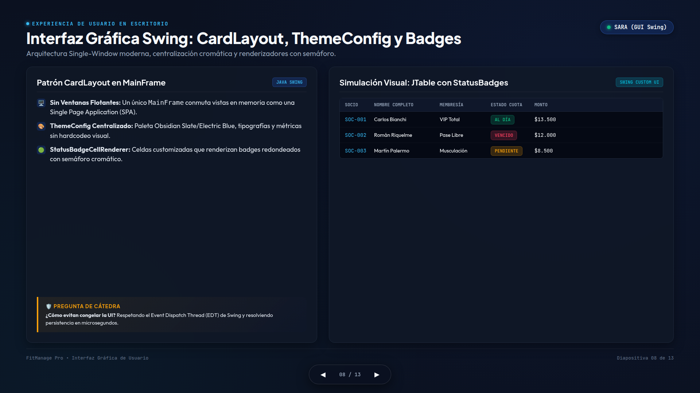
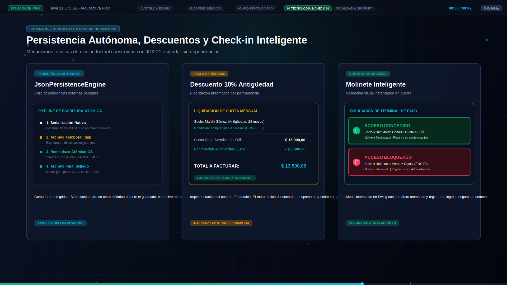
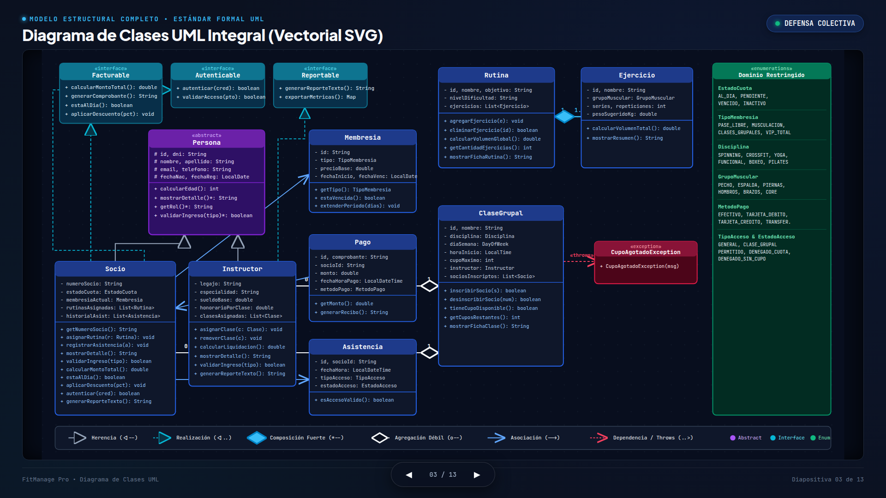

<div align="center">

# 🏋️‍♂️ FITMANAGE PRO
### Sistema Integral de Gestión Deportiva, Logística y Contable
**Cátedra:** Programación Orientada a Objetos / Laboratorio de Software  
**Tecnología:** Java 21 SE (LTS) &bull; Java Swing GUI &bull; Zero External Dependencies  
**Año Académico:** Noviembre 2026 &bull; Versión 1.0.0

[](https://openjdk.org/projects/jdk/21/)
[](https://docs.oracle.com/en/java/javase/21/docs/api/java.desktop/javax/swing/package-summary.html)
[](data/)
[](scripts/test.sh)
[](UML_DIAGRAM.md)

<p align="center">
  <a href="#-demostración-visual">Demostración Visual</a> &bull;
  <a href="#-descripción-del-proyecto">Descripción</a> &bull;
  <a href="#-principios-poo-implementados">Principios POO</a> &bull;
  <a href="#-stack-tecnológico">Stack</a> &bull;
  <a href="#-cómo-ejecutar-el-proyecto">Cómo Ejecutar</a> &bull;
  <a href="#-material-de-presentación-y-defensa">Material de Defensa</a> &bull;
  <a href="#-equipo-de-desarrollo">Equipo</a>
</p>

---

</div>

## 📸 Demostración Visual

### 🖥️ Interfaz Gráfica de Escritorio (Java Swing)
Panel central de administración con navegación fluida vía `CardLayout`, métricas ejecutivas en tiempo real y tablas con semáforos cromáticos de cuota.

<div align="center">
  
</div>

<br/>

### 🚪 Molinete Virtual y Control de Acceso en Tiempo Real
Modal interactivo (`CheckInDialog`) que valida estado de morosidad, aforo de sala y credenciales de acceso físico antes de autorizar el ingreso.

<div align="center">
  
</div>

<br/>

### 📐 Modelo Estructural UML (14 Clases & Relaciones Cardinales)
Diagrama de clases formal vectorizado que rige toda la solución, respetando encapsulamiento estricto (`#` protegido), composición fuerte, agregación débil y contratos de interfaz.

<div align="center">
  
</div>

---

## 📌 Descripción del Proyecto

**FitManage Pro** es una plataforma de software de escritorio concebida para digitalizar la operatoria integral de gimnasios y centros deportivos de alta complejidad. Resuelve de manera cohesionada tres problemáticas críticas de negocio:

1. **Gestión Operativa de Socios e Instructores:** Control de membresías (`VIP`, `PLUS`, `ESTUDIANTE`, `BASICO`), registro de asistencias y liquidación de haberes docentes por valor de hora cátedra.
2. **Logística de Clases y Planificación Deportiva:** Inscripción con aforo restringido en actividades grupales (CrossFit, Spinning, Pilates, Yoga, Funcional) y prescripción de rutinas de entrenamiento con dosificación milimétrica de ejercicios y cálculo automático de tonelaje global acumulado.
3. **Administración Financiera y Acceso Físico:** Facturación mensual con bonificación del 10% por fidelidad (socios con $\ge 12$ meses de antigüedad), emisión de recibos y simulación interactiva de check-in en molinetes.

---

## 🧠 Principios POO Implementados

El sistema fue diseñado como una pieza modelo para la cátedra, implementando sin atajos los pilares de la **Programación Orientada a Objetos**:

| Concepto POO | Implementación en FitManage Pro | Archivos Clave |
| :--- | :--- | :--- |
| **Herencia y Abstracción** | Clase base abstracta `Persona` que encapsula estado protegido (`#nombre`, `#dni`, `#email`, `#telefono`) y obliga la definición de `mostrarDetalle()` y `validarIngreso()`. | [`Persona.java`](src/com/clubdeportivo/model/Persona.java), [`Socio.java`](src/com/clubdeportivo/model/Socio.java), [`Instructor.java`](src/com/clubdeportivo/model/Instructor.java) |
| **Polimorfismo Dinámico** | Despacho polimórfico en tiempo de ejecución: `Socio.validarIngreso(TipoAcceso)` verifica morosidad y categoría; `Instructor.validarIngreso(TipoAcceso)` autoriza acceso irrestricto sin chequeo arancelario. | [`Persona.java`](src/com/clubdeportivo/model/Persona.java), [`AccesoService.java`](src/com/clubdeportivo/service/AccesoService.java) |
| **Composición Fuerte ($\blacklozenge\text{--}$)** | Relación existencial `Rutina *-- Ejercicio`. Los ejercicios nacen y mueren con la rutina contenedora; el cálculo de volumen global es acumulado recursivamente. | [`Rutina.java`](src/com/clubdeportivo/model/Rutina.java), [`Ejercicio.java`](src/com/clubdeportivo/model/Ejercicio.java) |
| **Agregación Débil ($\lozenge\text{--}$)** | Relaciones `ClaseGrupal o-- Instructor` y `ClaseGrupal o-- Socio`. Ambas partes tienen ciclos de vida independientes; desarmar una clase no elimina a los socios ni al docente. | [`ClaseGrupal.java`](src/com/clubdeportivo/model/ClaseGrupal.java) |
| **Interfaces de Contrato** | Segregación de interfaces (ISP): `Facturable` (cálculo de montos y recibos), `Autenticable` (credenciales y login), `Reportable` (exportación de métricas). | [`Facturable.java`](src/com/clubdeportivo/model/Facturable.java), [`Autenticable.java`](src/com/clubdeportivo/model/Autenticable.java) |
| **Excepciones de Negocio** | Excepción verificada (`checked exception`) `CupoAgotadoException`, asegurando robustez ante sobre-suscripción de capacidad física bajo el principio *Fail-Fast*. | [`CupoAgotadoException.java`](src/com/clubdeportivo/model/CupoAgotadoException.java) |
| **Persistencia Atómica** | Motor nativo `JsonPersistenceEngine` que implementa guardado en dos fases (`.tmp` + `StandardCopyOption.ATOMIC_MOVE`), garantizando cero corrupción ante cierres inesperados. | [`JsonPersistenceEngine.java`](src/com/clubdeportivo/util/JsonPersistenceEngine.java) |

---

## 🏗️ Arquitectura del Sistema (4 Capas)

```
┌─────────────────────────────────────────────────────────────┐
│                    CAPA DE PRESENTACIÓN                     │
│  MainFrame • DashboardPanel • SociosPanel • CheckInDialog   │
└──────────────────────────────┬──────────────────────────────┘
                               │
┌──────────────────────────────▼──────────────────────────────┐
│                    CAPA DE SERVICIOS                        │
│   SocioService • FacturacionService • AccesoService • ...   │
└──────────────────────────────┬──────────────────────────────┘
                               │
┌──────────────────────────────▼──────────────────────────────┐
│                   CAPA DE REPOSITORIOS                      │
│      IRepository<T, ID> • SocioRepository • PagoRepo • ...  │
└──────────────────────────────┬──────────────────────────────┘
                               │
┌──────────────────────────────▼──────────────────────────────┐
│               CAPA DE PERSISTENCIA Y MODELO                 │
│   JsonPersistenceEngine  ◄───►  Archivos Locales (.json)    │
└─────────────────────────────────────────────────────────────┘
```

---

## 🛠️ Stack Tecnológico

* **Lenguaje:** [Java 21 LTS](https://openjdk.org/projects/jdk/21/) (uso de Records, Switch Pattern Matching, Sequenced Collections).
* **Entorno Gráfico:** Java Swing & AWT (`CardLayout`, renderizadores de celda customizados, anti-aliasing vectorial).
* **Persistencia:** Archivos JSON planos con serializador propio en Java puro (sin dependencias pesadas como Gson o Jackson).
* **Testing:** Suite automatizada de pruebas unitarias y de integración ([`SistemaTest.java`](src/com/clubdeportivo/test/SistemaTest.java)).
* **Construcción y Ejecución:** Scripts Bash portables (`scripts/compile.sh`, `scripts/run.sh`, `scripts/test.sh`).
* **Dependencias Externas:** **0 (Cero dependencias npm, gradle o maven).** Compilable en cualquier distribución Linux, macOS o Windows con JDK 21.

---

## 🚀 Cómo Ejecutar el Proyecto

### 1. Requisitos Previos
Tener instalado el **JDK 21** o superior en el sistema. Puedes comprobarlo con:
```bash
java -version
javac -version
```

### 2. Clonar el Repositorio
```bash
git clone https://github.com/JuannIM/fitmanage-pro.git
cd fitmanage-pro
```

### 3. Compilación Limpia
Compila todas las clases Java del proyecto en el directorio `bin/`:
```bash
bash scripts/compile.sh
```

### 4. Ejecutar la Suite de Pruebas Automatizadas
Verifica el cumplimiento de las 7 aserciones cardinales de la cátedra:
```bash
bash scripts/test.sh
```
*Salida esperada:*
```text
===============================================================
  SUITE DE PRUEBAS AUTOMATIZADAS - FITMANAGE PRO (JAVA 21)     
===============================================================
  [TEST] 1. Herencia y Polimorfismo en Jerarquía Persona ... [PASS]
  [TEST] 2. Composición Fuerte: Rutina y Ejercicios (Volumen) ... [PASS]
  [TEST] 3. Control Estricto de Cupo y Lanzamiento de Excepción ... [PASS]
  [TEST] 4. Reglas de Facturación y Descuento por Antigüedad (10%) ... [PASS]
  [TEST] 5. Validación de Check-In en Molinete (AccesoService) ... [PASS]
  [TEST] 6. Persistencia JSON Round-Trip Atómica ... [PASS]
  [TEST] 7. Interfaces Autenticable y Liquidación Docente ... [PASS]
===============================================================
  RESUMEN DE EJECUCIÓN: 7/7 TESTS EXITOSOS (0 fallos)
===============================================================
```

### 5. Iniciar la Aplicación (Interfaz Gráfica)
Levanta la interfaz gráfica de escritorio de FitManage Pro precargada con datos semilla:
```bash
bash scripts/run.sh
```

---

## 🎬 Material de Presentación y Defensa

Para la exposición oral y evaluación del docente, se han preparado los siguientes artefactos interactivos:

| Entregable | Ubicación en el Repositorio | Descripción |
| :--- | :--- | :--- |
| **Video de Presentación Oficial** | [`video/fitmanage_presentacion.mp4`](video/fitmanage_presentacion.mp4) | Video HD (1080p) con locución, animación cinemática y recorrido por las 5 áreas clave del sistema. |
| **Reproductor Web del Video** | [`video/index.html`](video/index.html) | Interfaz web interactiva con audio, subtítulos y selector de escenas. |
| **Slideshow Interactivo** | [`presentacion_fitmanage.html`](presentacion_fitmanage.html) | Presentación completa de 13 diapositivas (16:9 1920×1080) construida bajo la especificación `frontend-slides` con atajo `E` de edición inline. |
| **Guion Oral en PDF** | [`guion_presentacion.pdf`](guion_presentacion.pdf) | Libreto cronometrado (18:30 min netos) con distribución equitativa de oratoria y defensas técnicas. |
| **Guion en Markdown** | [`guion_presentacion.md`](guion_presentacion.md) | Formato fuente en Markdown del guion expositivo. |
| **Documentación UML Exhaustiva** | [`UML_DIAGRAM.md`](UML_DIAGRAM.md) | Justificación conceptual de las 14 clases, estereotipos, conectores y decisiones de diseño. |

---

## 👥 Equipo de Desarrollo

Proyecto desarrollado de forma colaborativa simulando una célula ágil de 6 ingenieros:

| Integrante | Módulos Asignados | Conceptos POO Defendidos |
| :--- | :--- | :--- |
| **Juan** | Capa Arquitectónica & Módulo de Personas | Abstracción base `Persona`, atributos protegidos (`#`), polimorfismo de ingreso y arquitectura desacoplada en 4 capas. |
| **Rocio** | Módulo de Prescripción y Entrenamiento | Composición fuerte `Rutina *-- Ejercicio`, ciclo de vida existencial y acumulación de volumen en tonelaje. |
| **Merlina** | Módulo de Clases Grupales y Aforo | Agregación débil `ClaseGrupal o-- Socio/Instructor`, capacidad máxima y manejo de `CupoAgotadoException`. |
| **Alfonsina** | Módulo Financiero y Facturación | Contrato de interfaz `Facturable`, segregación de interfaces y beneficio del 10% de descuento por antigüedad. |
| **Sara** | Capa de Presentación Java Swing | Navegabilidad con `CardLayout`, consistencia visual `ThemeConfig` y lógica interactiva del modal `CheckInDialog`. |
| **Joel** | Persistencia, Testing y Calidad | Motor atómico `JsonPersistenceEngine`, repositorios desacoplados, suite `SistemaTest` y certificación Graphify. |

---

<div align="center">
  <sub>FitManage Pro &bull; Desarrollado para la Cátedra de Programación Orientada a Objetos &bull; 2026</sub>
</div>
