# DIAGRAMA DE CLASES UML Y DOCUMENTACIÓN TÉCNICA DEL MODELO POO
## FitManage Pro - Sistema Integral de Gestión para Club Deportivo / Gimnasio

> **Documento Académico de Modelado UML y Fundamentos de POO**  
> **Cátedra:** Programación Orientada a Objetos / Laboratorio de Software  
> **Integrantes del Grupo:** Juan, Rocio, Merlina, Alfonsina, Sara, Joel  
> **Versión:** 1.0.0 LTS  
> **Fecha:** Noviembre 2026  

---

## 1. INTRODUCCIÓN Y PROPÓSITO DEL MODELADO

El presente documento detalla formalmente el diseño de clases y la arquitectura orientada a objetos de **FitManage Pro**, modelado bajo los estándares de **UML (Unified Modeling Language)**. 

El modelo aborda el dominio sugerido por la cátedra (**Socios, Instructores, Clases Grupales y Rutinas**), enriqueciéndolo con subsistemas de **Membresías, Facturación y Control de Asistencias (Check-In)** en tiempo real. Se ilustran y justifican los conceptos cardinales de la Programación Orientada a Objetos:
1. **Abstracción:** Representación de conceptos del mundo real mediante tipos abstractos de datos.
2. **Encapsulamiento:** Ocultamiento de estado mediante visibilidades estrictas (`private -`, `protected #`, `public +`).
3. **Herencia:** Generalización y especialización a través de una clase base abstracta (`Persona`).
4. **Polimorfismo:** Sobreescritura dinámica de métodos en tiempo de ejecución.
5. **Composición Fuerte:** Ciclos de vida acoplados (`Rutina *-- Ejercicio`).
6. **Agregación Débil:** Ciclos de vida independientes con límites de aforo (`ClaseGrupal o-- Instructor`, `ClaseGrupal o-- Socio`).
7. **Interfaces:** Contratos de comportamiento desacoplados (`Facturable`, `Autenticable`, `Reportable`).

---

## 2. DIAGRAMA DE CLASES UML COMPLETO (SINTAXIS MERMAID)

```mermaid
classDiagram
    %% ==========================================
    %% INTERFACES (CONTRATOS DE COMPORTAMIENTO)
    %% ==========================================
    class Facturable {
        <<interface>>
        +calcularMontoTotal() double
        +generarComprobante() String
        +estaAlDia() boolean
        +aplicarDescuento(double porcentaje) void
    }

    class Autenticable {
        <<interface>>
        +autenticar(String credencial) boolean
        +validarAcceso(String puntoControl) boolean
        +actualizarClave(String nuevaClave) void
    }

    class Reportable {
        <<interface>>
        +generarReporteTexto() String
        +exportarMetricas() Map~String, Object~
    }

    %% ==========================================
    %% ENUMERACIONES (TIPOS DE DOMINIO RESTRINGIDO)
    %% ==========================================
    class EstadoCuota {
        <<enumeration>>
        AL_DIA
        PENDIENTE
        VENCIDO
        INACTIVO
        -String etiqueta
        +getEtiqueta() String
        +toString() String
    }

    class TipoMembresia {
        <<enumeration>>
        PASE_LIBRE
        MUSCULACION
        CLASES_GRUPALES
        VIP_TOTAL
        -String nombre
        -double precioBase
        -boolean permiteClases
        +getNombre() String
        +getPrecioBase() double
        +permiteClases() boolean
        +toString() String
    }

    class Disciplina {
        <<enumeration>>
        SPINNING
        CROSSFIT
        YOGA
        FUNCIONAL
        BOXEO
        PILATES
        -String nombreVisible
        +getNombreVisible() String
        +toString() String
    }

    class GrupoMuscular {
        <<enumeration>>
        PECHO
        ESPALDA
        PIERNAS
        HOMBROS
        BRAZOS
        CORE
        -String descripcion
        +getDescripcion() String
        +toString() String
    }

    class MetodoPago {
        <<enumeration>>
        EFECTIVO
        TARJETA_DEBITO
        TARJETA_CREDITO
        TRANSFERENCIA
        -String descripcion
        +getDescripcion() String
        +toString() String
    }

    class TipoAcceso {
        <<enumeration>>
        GENERAL
        CLASE_GRUPAL
        -String descripcion
        +getDescripcion() String
        +toString() String
    }

    class EstadoAcceso {
        <<enumeration>>
        PERMITIDO
        DENEGADO_CUOTA_VENCIDA
        DENEGADO_SIN_CUPO
        DENEGADO_MEMBRESIA_INSUFICIENTE
        DENEGADO_NO_ENCONTRADO
        -String mensaje
        -boolean aprobado
        +getMensaje() String
        +esAprobado() boolean
        +toString() String
    }

    %% ==========================================
    %% JERARQUÍA DE HERENCIA (PERSONA)
    %% ==========================================
    class Persona {
        <<abstract>>
        #String id
        #String dni
        #String nombre
        #String apellido
        #String email
        #String telefono
        #LocalDate fechaNacimiento
        #LocalDate fechaRegistro
        +getId() String
        +setId(String id) void
        +getDni() String
        +setDni(String dni) void
        +getNombre() String
        +setNombre(String nombre) void
        +getApellido() String
        +setApellido(String apellido) void
        +getNombreCompleto() String
        +getEmail() String
        +setEmail(String email) void
        +getTelefono() String
        +setTelefono(String telefono) void
        +getFechaNacimiento() LocalDate
        +setFechaNacimiento(LocalDate fechaNacimiento) void
        +getFechaRegistro() LocalDate
        +setFechaRegistro(LocalDate fechaRegistro) void
        +calcularEdad() int
        +mostrarDetalle()* String
        +getRol()* String
        +validarIngreso(TipoAcceso tipo)* boolean
    }

    class Socio {
        +int DIAS_GRACIA_CUOTA$
        -String numeroSocio
        -EstadoCuota estadoCuota
        -Membresia membresiaActual
        -List~Rutina~ rutinasAsignadas
        -List~Asistencia~ historialAsistencias
        -double porcentajeDescuentoManual
        +getNumeroSocio() String
        +setNumeroSocio(String numeroSocio) void
        +getEstadoCuota() EstadoCuota
        +setEstadoCuota(EstadoCuota estado) void
        +getMembresiaActual() Membresia
        +setMembresiaActual(Membresia m) void
        +asignarRutina(Rutina r) void
        +removerRutina(String rutinaId) void
        +registrarAsistencia(Asistencia a) void
        +getRutinasAsignadas() List~Rutina~
        +getHistorialAsistencias() List~Asistencia~
        +getPorcentajeDescuentoManual() double
        +calcularMesesAntiguedad() int
        +tieneDescuentoAntiguedad() boolean
        +mostrarDetalle() String
        +getRol() String
        +validarIngreso(TipoAcceso tipo) boolean
        +calcularMontoTotal() double
        +generarComprobante() String
        +estaAlDia() boolean
        +aplicarDescuento(double porcentaje) void
        +autenticar(String credencial) boolean
        +validarAcceso(String puntoControl) boolean
        +generarReporteTexto() String
        +exportarMetricas() Map~String, Object~
    }

    class Instructor {
        -String legajo
        -String especialidad
        -double sueldoBase
        -double honorarioPorClase
        -List~ClaseGrupal~ clasesAsignadas
        -String turnoDisponibilidad
        +getLegajo() String
        +setLegajo(String legajo) void
        +getEspecialidad() String
        +setEspecialidad(String especialidad) void
        +getSueldoBase() double
        +setSueldoBase(double sueldoBase) void
        +getHonorarioPorClase() double
        +setHonorarioPorClase(double honorarioPorClase) void
        +getClasesAsignadas() List~ClaseGrupal~
        +getTurnoDisponibilidad() String
        +setTurnoDisponibilidad(String turnoDisponibilidad) void
        +asignarClase(ClaseGrupal c) void
        +removerClase(ClaseGrupal c) void
        +calcularLiquidacionMensual() double
        +mostrarDetalle() String
        +getRol() String
        +validarIngreso(TipoAcceso tipo) boolean
        +generarReporteTexto() String
        +exportarMetricas() Map~String, Object~
    }

    %% ==========================================
    %% ENTIDADES DEL DOMINIO DEPORTIVO Y GESTIÓN
    %% ==========================================
    class Ejercicio {
        -String id
        -String nombre
        -GrupoMuscular grupoMuscular
        -int series
        -int repeticiones
        -double pesoSugeridoKg
        -int descansoSegundos
        -String notasTecnicas
        +getId() String
        +setId(String id) void
        +getNombre() String
        +setNombre(String nombre) void
        +getGrupoMuscular() GrupoMuscular
        +setGrupoMuscular(GrupoMuscular grupoMuscular) void
        +getSeries() int
        +setSeries(int series) void
        +getRepeticiones() int
        +setRepeticiones(int repeticiones) void
        +getPesoSugeridoKg() double
        +setPesoSugeridoKg(double pesoSugeridoKg) void
        +getDescansoSegundos() int
        +setDescansoSegundos(int descansoSegundos) void
        +getNotasTecnicas() String
        +setNotasTecnicas(String notasTecnicas) void
        +calcularVolumenTotal() double
        +mostrarResumen() String
    }

    class Rutina {
        -String id
        -String nombre
        -String objetivo
        -String nivelDificultad
        -LocalDate fechaCreacion
        -LocalDate fechaRevision
        -String instructorCreadorId
        -List~Ejercicio~ ejercicios
        +getId() String
        +setId(String id) void
        +getNombre() String
        +setNombre(String nombre) void
        +getObjetivo() String
        +setObjetivo(String objetivo) void
        +getNivelDificultad() String
        +setNivelDificultad(String nivelDificultad) void
        +getFechaCreacion() LocalDate
        +setFechaCreacion(LocalDate fechaCreacion) void
        +getFechaRevision() LocalDate
        +setFechaRevision(LocalDate fechaRevision) void
        +getInstructorCreadorId() String
        +setInstructorCreadorId(String instructorCreadorId) void
        +agregarEjercicio(Ejercicio e) void
        +eliminarEjercicio(String ejercicioId) boolean
        +vaciarEjercicios() void
        +getEjercicios() List~Ejercicio~
        +calcularVolumenGlobal() double
        +getCantidadEjercicios() int
        +mostrarFichaRutina() String
    }

    class ClaseGrupal {
        -String id
        -String nombre
        -Disciplina disciplina
        -DayOfWeek diaSemana
        -LocalTime horaInicio
        -int duracionMinutos
        -String sala
        -int cupoMaximo
        -Instructor instructor
        -List~Socio~ sociosInscriptos
        +getId() String
        +setId(String id) void
        +getNombre() String
        +setNombre(String nombre) void
        +getDisciplina() Disciplina
        +setDisciplina(Disciplina disciplina) void
        +getDiaSemana() DayOfWeek
        +setDiaSemana(DayOfWeek diaSemana) void
        +getHoraInicio() LocalTime
        +setHoraInicio(LocalTime horaInicio) void
        +getDuracionMinutos() int
        +setDuracionMinutos(int duracionMinutos) void
        +getSala() String
        +setSala(String sala) void
        +getCupoMaximo() int
        +setCupoMaximo(int cupoMaximo) void
        +getInstructor() Instructor
        +setInstructor(Instructor i) void
        +getSociosInscriptos() List~Socio~
        +inscribirSocio(Socio s) boolean
        +restaurarInscripcion(Socio s) void
        +desinscribirSocio(String numeroSocio) boolean
        +tieneCupoDisponible() boolean
        +getCuposRestantes() int
        +mostrarFichaClase() String
    }

    class Membresia {
        -String id
        -TipoMembresia tipo
        -double precioBase
        -LocalDate fechaInicio
        -LocalDate fechaVencimiento
        -boolean renovacionAutomatica
        +getId() String
        +setId(String id) void
        +getTipo() TipoMembresia
        +setTipo(TipoMembresia tipo) void
        +getPrecioBase() double
        +setPrecioBase(double precioBase) void
        +getFechaInicio() LocalDate
        +setFechaInicio(LocalDate fechaInicio) void
        +getFechaVencimiento() LocalDate
        +setFechaVencimiento(LocalDate fechaVencimiento) void
        +isRenovacionAutomatica() boolean
        +setRenovacionAutomatica(boolean renovacionAutomatica) void
        +estaVencida() boolean
        +estaEnPeriodoGracia(int diasGracia) boolean
        +extenderPeriodo(int dias) void
    }

    class Pago {
        -String id
        -String numeroComprobante
        -String socioId
        -double monto
        -LocalDateTime fechaHoraPago
        -MetodoPago metodoPago
        -String concepto
        +getId() String
        +setId(String id) void
        +getNumeroComprobante() String
        +setNumeroComprobante(String numeroComprobante) void
        +getSocioId() String
        +setSocioId(String socioId) void
        +getMonto() double
        +setMonto(double monto) void
        +getFechaHoraPago() LocalDateTime
        +setFechaHoraPago(LocalDateTime fechaHoraPago) void
        +getMetodoPago() MetodoPago
        +setMetodoPago(MetodoPago metodoPago) void
        +getConcepto() String
        +setConcepto(String concepto) void
        +generarReciboImprimible() String
    }

    class Asistencia {
        <<immutable>>
        -String id
        -String socioId
        -LocalDateTime fechaHora
        -TipoAcceso tipoAcceso
        -String claseId
        -EstadoAcceso estadoAcceso
        -String observacion
        +getId() String
        +getSocioId() String
        +getFechaHora() LocalDateTime
        +getTipoAcceso() TipoAcceso
        +getClaseId() String
        +getEstadoAcceso() EstadoAcceso
        +getObservacion() String
        +esAccesoValido() boolean
    }

    class Exception
    class RuntimeException

    class CupoAgotadoException {
        <<exception>>
        -long serialVersionUID$
        -String idClase
        -int cupoMaximo
        +CupoAgotadoException(String idClase, String nombreClase, int cupoMaximo)
        +getIdClase() String
        +getCupoMaximo() int
    }

    class PersistenceException {
        <<exception>>
        -long serialVersionUID$
        +PersistenceException(String message)
        +PersistenceException(String message, Throwable cause)
    }

    Exception <|-- CupoAgotadoException : Herencia
    RuntimeException <|-- PersistenceException : Herencia

    %% ==========================================
    %% RELACIONES ESTRUCTURALES Y DEPENDENCIAS
    %% ==========================================
    Persona <|-- Socio : Herencia (Generalización)
    Persona <|-- Instructor : Herencia (Generalización)

    Facturable <|.. Socio : Realización (Implementa)
    Autenticable <|.. Socio : Realización (Implementa)
    Reportable <|.. Socio : Realización (Implementa)
    Reportable <|.. Instructor : Realización (Implementa)

    Rutina "1" *-- "1..*" Ejercicio : Composición Fuerte
    ClaseGrupal "1" o-- "0..1" Instructor : Agregación Débil
    ClaseGrupal "1" o-- "0..*" Socio : Agregación Débil

    Socio "1" --> "1" Membresia : Asociación Unidireccional
    Socio "1" --> "0..*" Asistencia : Asociación (Registra)
    Socio "1" --> "0..*" Rutina : Asociación (Tiene Asignadas)
    Pago "0..*" --> "1" Socio : Asociación (Facturado a)
    Asistencia "0..*" ..> "0..1" ClaseGrupal : Dependencia Opcional
    ClaseGrupal ..> CupoAgotadoException : Lanza (Throws)
```



---

## 3. EXPLICACIÓN DETALLADA DE CADA ELEMENTO DEL MODELO

### 3.1 Interfaces (Contratos de Negocio)
Las interfaces representan un acuerdo formal de métodos que una clase se compromete a implementar, desacoplando el **qué hace** del **cómo lo hace**:

1. **`Facturable`**:
   - **Propósito:** Permite tratar a cualquier entidad susceptible de cobro de manera polimórfica en el módulo de caja.
   - `calcularMontoTotal()`: Computa el valor neto a abonar considerando la tarifa base de la membresía, descuentos por antigüedad (10% si supera 12 meses) y eventuales recargos por mora.
   - `generarComprobante()`: Emite una representación formal del recibo impositivo con numeración correlativa.
   - `estaAlDia()`: Valida si la entidad no registra deuda vencida.
   - `aplicarDescuento(double)`: Permite bonificaciones personalizadas.

2. **`Autenticable`**:
   - **Propósito:** Estandariza la seguridad para identificar personas en el sistema (por DNI, email o N° de Socio).
   - `autenticar(String)`: Verifica credenciales en un punto de acceso.
   - `validarAcceso(String)`: Comprueba si tiene privilegios para acceder a una sala o recurso particular.
   - `actualizarClave(String)`: Método `default` extensible para actualizar la credencial asignada.

3. **`Reportable`**:
   - **Propósito:** Habilita a las entidades a exportar métricas estructuradas para el panel de estadísticas y auditoría gerencial.

---

### 3.2 Jerarquía de Herencia: `Persona` (Clase Base Abstracta)
- **¿Por qué es una clase `abstract`?**  
  En el dominio de un club no tiene sentido instanciar una persona genérica; todo individuo que interactúa con el club tiene una razón de ser específica: es un **Socio** o es un **Instructor**. Declararla abstracta impide su instanciación directa (`new Persona()` daría error de compilación).
- **Atributos Protegidos (`#`):**  
  Se declaran como `protected` (`id`, `dni`, `nombre`, `apellido`, `email`, `telefono`, `fechaNacimiento`, `fechaRegistro`) para que las subclases puedan acceder a ellos directamente mientras permanecen encapsulados frente a clases externas fuera del paquete.
- **Métodos Concretos Reutilizables:**  
  `calcularEdad()` utiliza `Period.between(fechaNacimiento, LocalDate.now())` y es compartido automáticamente por socios y profesores sin duplicar código.
- **Métodos Abstractos (Polimorfismo Forzado):**
  - `mostrarDetalle()`: Obliga a `Socio` a imprimir su número de legajo y estado de cuota, y a `Instructor` a mostrar su especialidad y honorarios.
  - `validarIngreso(TipoAcceso)`: Obliga a cada clase a definir sus reglas de acceso físico.

---

### 3.3 Subclase: `Socio`
- Extiende de `Persona` e implementa `Facturable`, `Autenticable` y `Reportable`.
- **Encapsulamiento:** Mantiene su `numeroSocio`, `estadoCuota`, `membresiaActual`, `porcentajeDescuentoManual`, colección de rutinas y asistencias en estado privado, además de la constante `DIAS_GRACIA_CUOTA = 5`.
- **Regla Polimórfica de Acceso:**  
  Sobrescribe `validarIngreso(TipoAcceso tipo)`: rechaza socios con estado `VENCIDO` o `INACTIVO` (y con estado `AL_DIA` si la membresía está vencida), tolera estado `PENDIENTE` únicamente dentro del período de gracia de `DIAS_GRACIA_CUOTA` días (`Membresia.estaEnPeriodoGracia`), y verifica `permiteClases()` cuando el acceso es `CLASE_GRUPAL`.

---

### 3.4 Subclase: `Instructor`
- Extiende de `Persona` e implementa `Reportable`.
- Posee datos laborales: `legajo`, `especialidad`, `sueldoBase` y `honorarioPorClase`.
- **Lógica Salarial:**  
  El método `calcularLiquidacionMensual()` calcula:
  $$\text{Liquidación} = \text{SueldoBase} + (\text{ClasesSemanales} \times 4 \times \text{HonorarioPorClase}) + \text{BonoEspecialidad}$$

---

### 3.5 Relación de Composición Fuerte (`*--`): `Rutina` y `Ejercicio`
- **Símbolo UML:** Rombo negro relleno en el extremo de `Rutina` (`Rutina *-- Ejercicio`).
- **Definición y Justificación:**  
  La composición denota una relación de pertenencia existencial. Un `Ejercicio` dentro de una rutina (con 4 series, 12 repeticiones a 70 kg con 60 s de pausa) es una prescripción personalizada que carece de sentido ontológico e independiente fuera de esa rutina.
- **Ciclo de Vida Ligado:**  
  Si la rutina es destruida o eliminada del sistema, sus ejercicios componentes desaparecen con ella. La rutina es la encargada de instanciar y agregar sus ejercicios.
- **Cálculo de Tonelaje (Volumen Global):**  
  `Rutina.calcularVolumenGlobal()` itera sobre su lista de ejercicios sumando:
  $$\text{Volumen} = \sum_{i=1}^{n} (\text{Series}_i \times \text{Repeticiones}_i \times \text{PesoKg}_i)$$

---

### 3.6 Relación de Agregación Débil (`o--`): `ClaseGrupal` con `Instructor` y `Socio`
- **Símbolo UML:** Rombo blanco vacío en el extremo de `ClaseGrupal` (`ClaseGrupal o-- Instructor` y `ClaseGrupal o-- Socio`).
- **Definición y Justificación:**  
  La agregación modela una relación de "todo-parte" donde los componentes tienen ciclos de vida totalmente independientes del contenedor.
- **Independencia de Ciclo de Vida:**  
  Si una clase de Spinning se cancela o se da de baja del cronograma:
  - El **Instructor** asignado no desaparece del club (sigue empleado y dictando otras clases).
  - Los **Socios** inscriptos no son eliminados del padrón del club.
- **Control de Aforo y Excepción de Negocio:**  
  `ClaseGrupal` contiene un atributo `cupoMaximo`. Si un socio intenta inscribirse mediante `inscribirSocio(Socio s)` y `sociosInscriptos.size() >= cupoMaximo`, el método rechaza la operación y lanza formalmente la excepción `CupoAgotadoException`.

---

### 3.7 Relaciones de Asociación (`-->`)
1. **`Socio --> Membresia` (1 a 1):**  
   Cada socio tiene asociada una única membresía vigente en un instante de tiempo, que define su precio base y si tiene habilitado el acceso a clases grupales.
2. **`Socio --> Asistencia` (1 a N):**  
   El socio mantiene un registro histórico unidireccional de cada vez que atravesó el molinete o ingresó a una sala.
3. **`Pago --> Socio` (N a 1):**  
   Cada transacción de pago se asocia al socio emisor, guardando el número de comprobante, fecha, monto y método de pago (`EFECTIVO`, `TARJETA_DEBITO`, etc.).

---

## 4. GUÍA DE DEFENSA ORAL ANTE LA CÁTEDRA (PREGUNTAS FRECUENTES)

Al defender este proyecto en un examen final o coloquio, las preguntas habituales de los docentes y sus respuestas fundamentadas son:

### P1: ¿Por qué usaron una clase abstracta `Persona` en lugar de una interfaz?
> **Respuesta:**  
> Usamos una clase abstracta porque `Socio` e `Instructor` comparten no solo comportamiento, sino también **estado común** (`dni`, `nombre`, `apellido`, `email`, `telefono`, `fechaNacimiento`). En Java, las interfaces no pueden almacenar estado de instancia mutable (solo constantes estáticas). La clase abstracta nos permite aplicar el principio DRY (Don't Repeat Yourself), centralizando atributos y métodos concretos compartidos como `calcularEdad()`.

### P2: ¿Cuál es la diferencia concreta entre la composición de `Rutina`/`Ejercicio` y la agregación de `ClaseGrupal`/`Socio`?
> **Respuesta:**  
> La diferencia radica en la dependencia del ciclo de vida:  
> - En la **Composición (`Rutina *-- Ejercicio`)**, el ejercicio es una parte integral de la rutina. Si la rutina se borra, sus ejercicios se destruyen porque no tienen sentido de existir aislados.  
> - En la **Agregación (`ClaseGrupal o-- Socio`)**, la clase coordina a los socios, pero si la clase se cancela, los socios continúan existiendo en el club. Tienen ciclos de vida desacoplados.

### P3: ¿Dónde se evidencia el Polimorfismo en tiempo de ejecución?
> **Respuesta:**  
> Se evidencia en la llamada a métodos abstractos sobre colecciones polimórficas de tipo base `Persona`:
> ```java
> List<Persona> personas = new ArrayList<>();
> personas.add(new Socio(...));
> personas.add(new Instructor(...));
> for (Persona p : personas) {
>     System.out.println(p.mostrarDetalle()); // Enlace dinámico según el objeto real
> }
> ```
> Además, en el módulo de facturación, la interfaz `Facturable` permite cobrar tanto a socios como a cualquier otra futura entidad facturable (ej. eventos, alquiler de canchas) invocando `calcularMontoTotal()` sin conocer la implementación concreta.

### P4: ¿Cómo aseguraron la robustez del software ante situaciones límite?
> **Respuesta:**  
> Mediante validaciones preventivas en cada capa:
> 1. Validaciones de formato (DNI numérico, email con `@`) en `ValidationUtils`.
> 2. Regla de cupo estricto con lanzamiento de excepción de negocio `CupoAgotadoException`.
> 3. Control de acceso en molinete (`AccesoService`): socios con cuota `VENCIDO` son denegados en tiempo real.
> 4. Persistencia atómica en JSON escribiendo en archivos temporales antes de realizar un reemplazo definitivo (`ATOMIC_MOVE`), evitando la pérdida o corrupción de datos.

---

## 5. TRAZABILIDAD DE LOS INTEGRANTES DEL GRUPO

| Integrante | Áreas y Módulos de Trabajo |
| :--- | :--- |
| **Juan** | Jerarquía de herencia `Persona`, `Socio`, interfaces `Autenticable` y `Reportable`. |
| **Rocio** | Composición `Rutina *-- Ejercicio`, dosificación de cargas y cálculo de volumen global. |
| **Merlina** | `ClaseGrupal`, cronograma, cupos máximos y excepción `CupoAgotadoException`. |
| **Alfonsina** | `Membresia`, `Pago`, interface `Facturable`, 10% descuento por antigüedad y recibos. |
| **Sara** | `MainFrame`, `DashboardPanel`, CardLayout, Badges semafóricos de estado y Check-In Dialog. |
| **Joel** | Motor `JsonPersistenceEngine`, repositorios, suite de tests y scripts de compilación. |

---
*Documento generado para la presentación formal del proyecto FitManage Pro.*
